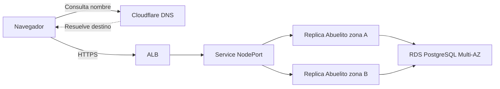

# Como funciono el despliegue de Abuelito

El entorno se valido el 31 de octubre de 2026: el usuario creo y consulto el
pedido 1 en https://dev.miguelinfra.com/pedido/1. Despues solicito retirar los
recursos. Consultar el registro de destruccion para saber que sigue existiendo;
los archivos de despliegue exitoso son evidencia historica.

## Las piezas y su responsabilidad

| Pieza | Que hacia |
|---|---|
| GitHub, Abuelito_Abuelito | Guarda codigo, historial, Terraform, Kubernetes, workflows y registros; no guarda el servidor ejecutandose |
| Docker | Empaqueta la aplicacion web y, por separado, las herramientas/migraciones de Prisma |
| ECR | Conservaba las imagenes Docker publicadas para que EKS pudiera descargarlas |
| Terraform | Creaba y eliminaba infraestructura AWS declarada en archivos .tf |
| S3 | Guardaba el state de Terraform, con versiones y bloqueo para evitar dos cambios simultaneos |
| VPC y subredes | Formaban la red: dos zonas, con subred publica y privada en cada una |
| NAT Gateway, uno por zona | Permitian salida a Internet desde la red privada; no recibian visitas del publico |
| EKS | Administraba Kubernetes; los dos nodos EC2 ARM64 ejecutaban los contenedores |
| Deployment Kubernetes | Mantenia dos replicas web, distribuidas entre las dos zonas |
| Service NodePort | Daba un destino estable al ALB en el puerto 30080 de los nodos |
| ALB | Recibia las visitas y enviaba trafico a los nodos; sus comprobaciones marcaban ambos destinos healthy |
| ACM | Aportaba el certificado HTTPS existente para el dominio |
| Cloudflare DNS | Hacia que dev.miguelinfra.com apuntara al nombre del ALB |
| RDS PostgreSQL 16.15 Multi-AZ | Guardaba tablas y pedidos; tenia redundancia gestionada entre zonas |
| Prisma | Aplicaba cinco migraciones SQL para construir la estructura de PostgreSQL |
| CloudWatch | Reunia logs, metricas, tablero y alarmas del entorno |
| IAM y OIDC | Permitian que los jobs de GitHub obtuvieran permisos AWS temporales sin guardar claves permanentes |
| Runner privado efimero | Una EC2 ARM64 sin IP publica ni SSH ejecutaba un solo job de deploy y se eliminaba al terminar |

## Recorrido de una visita

Con DNS only, Cloudflare respondia la consulta DNS; el trafico HTTPS iba del
navegador al ALB. El NAT no era el balanceador y no estaba en el recorrido de
entrada de las visitas. Lo usaban los recursos privados para sus conexiones de
salida, por ejemplo descargar paquetes o comunicarse con GitHub.

EKS incluye un plano de control administrado. Los nodos son las maquinas donde
corren los pods. Tener dos nodos no garantiza dos copias de la aplicacion:
por eso el Deployment especificaba replicas=2 y una restriccion de distribucion
por zona. Verificamos una replica Ready en cada zona.

RDS Multi-AZ tampoco significa dos bases independientes que la aplicacion deba
elegir. La aplicacion usa un endpoint; AWS gestiona la instancia primaria y su
redundancia. No hicimos una prueba de fallo o conmutacion.

## Imagen, estructura y datos son cosas diferentes

La imagen web era exactamente la que habias aceptado, identificada por su digest
sha256:6d91eb6c630d2a8f582de6d685f2530bb3d8f5078826d625bd84a7fb04f50ccb.
No se reconstruyo para recuperar este despliegue.

Otra imagen llevaba Prisma y las migraciones. Comprobamos los hashes del esquema
y cinco archivos SQL dentro de esa imagen y contra los archivos de Git. Las
migraciones crearon la estructura; el pedido lo creaste tu despues en la pagina.
Los pedidos no se guardan dentro de la imagen ni aparecen automaticamente por
construir el codigo.

DATABASE_URL elige servidor, base, usuario y password efectivos. Se crearon dos
usuarios: abuelito_app para operaciones de negocio y abuelito_migrator para
modificar la estructura. Las conexiones se guardaron como Secrets en Kubernetes.
El secreto temporal del administrador se elimino tras preparar los usuarios.
Los registros de Git identifican endpoint y DbiResourceId sin contrasenas.

## Que hicieron los pipelines

1. CI compilo la aplicacion, valido Terraform y comprobo identificadores de
   release. Hacer push no desplegaba automaticamente ni creaba pedidos.
2. La configuracion IAM/S3 se preparo antes de crear el laboratorio. OIDC dio
   credenciales temporales diferentes a build, infraestructura y deploy.
3. Terraform creo VPC, dos NAT, EKS, dos nodos, RDS, ALB y monitoreo. Esta
   recuperacion inicial se aplico con el operador desde la Mac; el despliegue de
   aplicacion posterior se ejecuto realmente en GitHub Actions.
4. Volvimos a publicar las dos imagenes validadas, sin reconstruirlas. El
   bootstrap de PostgreSQL preparo usuarios/Secrets desde la identidad del operador.
5. Se creo un runner privado de un solo uso. El workflow de comprobacion valido
   acceso privado a EKS; despues se elimino ese runner.
6. Creamos otro runner. Tras tu aprobacion dev-deploy, recover-validated.yml aplico
   migraciones, actualizo el Deployment y espero a que las dos replicas estuvieran
   listas. La ejecucion 41270677490 termino correctamente.
7. Actualizaste el CNAME y creaste/consultaste el pedido. Esa fue la prueba
   funcional manual registrada; el agente no creo pedidos de prueba.

El workflow build-images.yml sirve para versiones nuevas: construye web y migrator
del mismo commit y produce un release con sus digests. La ruta recover-validated
sirve exclusivamente para la pareja historica aceptada. Su commit original no
esta demostrado; no lo inventamos. deployment_commit identifica los scripts y
manifiestos de recuperacion, no el origen del binario antiguo.

En Dockerfile, runner es el nombre de la etapa que empaqueta la web. El runner
de GitHub es la maquina que ejecuta el job: son dos cosas diferentes que usan
la misma palabra.

El runner no se crea automaticamente para cada job en esta version del proyecto.
El operador lo crea y registra antes del deploy. Es una parte que se puede
automatizar despues; no debemos presentar el sistema como totalmente automatico.

## Que significa destruir

Terraform elimina recursos reales usando su state. Borrar los archivos locales o
el repositorio de GitHub no elimina EKS, RDS ni los cargos de esas maquinas.
Destruir infraestructura tampoco borra el codigo guardado en Git.

Se retira primero el runner y su regla de red; luego el laboratorio. RDS genera
su snapshot final. Los estados se respaldan y el bucket se retira al final con
los roles de CI. Las imagenes se conservan en el archivo Docker local verificado,
aunque se borre ECR. Los snapshots conservados pueden generar cargos de almacenamiento ([documentacion de AWS](https://docs.aws.amazon.com/AmazonRDS/latest/UserGuide/USER_WorkingWithAutomatedBackups.html)).

ACM y el proveedor OIDC existentes son compartidos, igual que los recursos de
otros proyectos: no forman parte de este retiro. El dominio sigue siendo tuyo.
Su CNAME puede quedar apuntando al ALB eliminado hasta actualizarlo o retirarlo.

Para recrear el laboratorio completo hay que crear primero IAM/S3; luego la red
y los servicios; republicar imagenes; preparar usuarios/migraciones y desplegar.
El plan cambia IDs/endpoints y debe revisarse. No se restaura un state antiguo de
recursos activos sobre un entorno nuevo. Un snapshot solo restaura datos si lo
seleccionamos expresamente: crear una base nueva no lo restaura por si solo.

## Donde estudiar

- Aplicacion: raiz del repositorio; estructura SQL en prisma/.
- AWS del laboratorio: deploy/terraform/.
- Base de pipelines IAM/S3: deploy/bootstrap/.
- Runner privado: deploy/runner/.
- Aplicacion en Kubernetes: deploy/kubernetes/abuelito.yaml.template.
- Automatizacion: .github/workflows/ y deploy/scripts/.
- Identidad exacta y resultados: deploy/records/recovery-release.json,
  database-bootstrap-20261031.json y aws-recovery-20261031.json.
- Destruccion y recursos conservados: el registro de destruccion correspondiente.

Los archivos son estudiables y reutilizables. Un registro de exito demuestra esa
ejecucion y ese alcance: no demuestra pruebas de reinicio, failover, restauracion
ni seguridad que no hayamos realizado.
